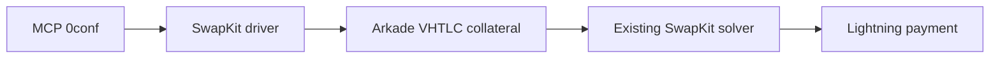

# Public 0conf MCP/API

Small `node:http` wrapper around the existing outgoing SwapKit driver: one BOLT11 payment from the existing Nuri card Arkade wallet, using preconfirmed Arkade VHTLC collateral and the existing SwapKit solver corridor. It adds no node, CLN, regtest, arkd, swap protocol, framework, or dependency.

## Status and evidence

- **Mainnet flow proven before this wrapper change:** order `ord_d073e885c6d9b72483388085abffb227b29e970f8143ab1feed0840b44a56076`, Ark funding transaction `7d762a0ac6e8f537df44f48708d34bc66b41970803e2e6d706ef962cf2af3fd1`, **1000 sats settled**. The returned preimage's SHA256 matched the invoice payment hash.
- **This branch:** packages that flow; it does not claim a new live call, deployment, refund execution, or reverse-flow proof.
- The card follow-up cosign fixes are retained: each signature request carries its own PSBT, and checkpoint signatures are preserved when inputs are updated.

## Start

Requires Node `>=22.13.0 <27` and the existing local card configuration. Copy `config/card-mainnet.example.json` to `.run/card.json` and fill it locally. Keep it and the journal outside git; card credentials are never accepted in MCP arguments or intentionally returned in responses.

```bash
npm ci
CARD_CONFIG="$PWD/.run/card.json" JOURNAL_PATH="$PWD/.run/0conf.journal.json" HOST=0.0.0.0 PORT=3000 npm start
```

The exact server command is the last line above. Default host is `127.0.0.1`; `HOST=0.0.0.0` exposes the unauthenticated API to the network, so use it only on an intended trusted interface. `GET /healthz` returns `{ "ok": true, "git_sha": "..." }` from `git rev-parse HEAD`, or the explicit `GIT_SHA` override.

## MCP surface

`POST /mcp` supports JSON-RPC `initialize`, `tools/list`, and `tools/call`. The catalog contains exactly one tool, **`0conf`**, with actions:

| Action | Default behavior | `execute: true` |
| --- | --- | --- |
| `quote` | Read-only route quote and local quote journal | No additional money action |
| `create` | Dry run; no order commit | Creates/binds the SwapKit order |
| `finalize` | Dry run; no intent, card signature, or funding | Performs/resumes funding and evidence submission |
| `track` | Read-only provider status/evidence refresh | No additional money action |

All calls require `invoice` and exact `amountSats`; `finalize` and `track` also require the full `orderId`. Use the same journal for every retry. The existing CLI and its explicit `--execute` gate remain available in [`docs/PARENT_COMMANDS.md`](docs/PARENT_COMMANDS.md).

Dry MCP example:

```bash
curl -sS http://127.0.0.1:3000/mcp \
  -H 'content-type: application/json' \
  --data '{"jsonrpc":"2.0","id":1,"method":"tools/call","params":{"name":"0conf","arguments":{"action":"create","invoice":"lnbc...","amountSats":1000}}}'
```

Successful calls return both MCP text content and `structuredContent`. Receipts follow [`schema/receipt.schema.json`](schema/receipt.schema.json) and always carry `orderId`, `fundingOutpoint`, and `finalStatus` (nullable before the corresponding stage). `preimage` is non-null only when its SHA256 matches the invoice payment hash. Provider `COMPLETED`, `FILLED`, and `SETTLED` states, including a settled `rawProviderState`, map to final status `COMPLETED`; unknown non-final states remain visible rather than failing.



## Verify

```bash
npm test
```

The suite uses synthetic provider/wallet fixtures and an ephemeral loopback HTTP server. It covers the one-tool catalog, dry/execute gating, settled-state mapping, per-PSBT cosign binding, replay/crash handling, and credential leakage. Fixtures are not mainnet proof.

Cloud orb `orb-8dce14dae58b` on Node `v20.19.2` passed all 14 JavaScript syntax checks and the server suite **4/4 in three consecutive runs**. The full dependency-backed `npm test` was not run in this branch: the existing agent box timed out over SSH and the isolated orb had no installed dependencies. Run the command above on the required Node version before release.

## Remaining work and limits

- **Reverse flow (Lightning → Arkade):** implement the reverse SwapKit quote/order binding, issue and bind an incoming Lightning invoice/preimage, define the opposite VHTLC collateral and claim/refund paths, reconcile inbound payment before releasing Arkade funds, add restart/replay and failure fixtures, then run a separate mainnet proof. None of that is exposed by this outgoing-only tool.
- Outgoing solver refunds are tracked as `REFUND_READY`/`REFUND_PENDING`; refund signing/broadcast is not implemented.
- After restart, an in-memory Nuri approval session cannot be reconstructed. Existing funding evidence remains resubmittable, but `send/complete` can be `UNAVAILABLE_AFTER_RESTART`.
- No production deployment, hardware call, or new real-money execution is claimed for this wrapper.
