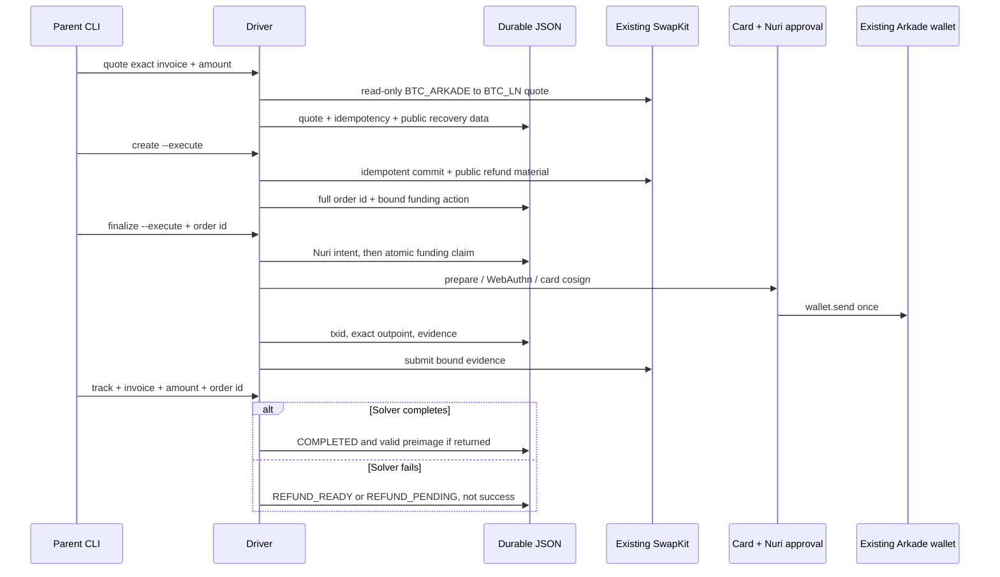

# Nuri card → Lightning, one outgoing payment

Standalone driver for one BOLT11 payment from the existing card Arkade wallet through the existing SwapKit v2 `BTC_ARKADE → BTC_LN` corridor. It does not contain CLN, regtest, Boltz, a node, or a new swap protocol. The request uses the production corridor's exact assets, settle target, capabilities, and signer class (`src/driver.js:87-109`), and the client requires SwapKit contract 2.2+ (`src/swapkit.js:69-100`).

**Status:** source and synthetic fixtures only. A real quote, order, card signature, Ark funding transaction, Lightning payment, refund, or production deployment is **UNVERIFIED**. No live call was made while building this branch.

## What is implemented

- `quote`, `create`, `finalize`, and `track` CLI commands (`cli.js:9-25`, `cli.js:46-52`). Create and funding require `--execute`; quote/status are read-only server operations (`src/driver.js:113-122`, `src/driver.js:159-184`, `src/driver.js:207-216`).
- Exact mainnet invoice prefix, amount, payment-hash, expiry, journaled invoice, and full `ord_…` binding (`src/invoice.js:24-57`, `src/invoice.js:60-76`).
- Stable commit idempotency key and SwapKit recovery key persisted with the accepted quote before commit (`src/driver.js:97-109`, `src/driver.js:121-141`).
- Existing Nuri swap-intent → send/prepare → card WebAuthn → send/cosign → send/complete approval path (`src/nuri-api.js:20-46`, `src/card-wallet.js:95-129`, `src/card-wallet.js:169-189`). The Ark provider must also report `network=bitcoin` before wallet creation (`src/card-wallet.js:150-160`).
- AID3 host bridge default `4E5552494D55473301`, calling the existing signer's `sign-input-send` command and requiring aggregate signature verification (`src/card-host.js:6-20`, `src/card-host.js:37-53`).
- Durable JSON with mode-0600 temp files, fsync, atomic rename, and a fail-closed cross-process lock. Recovery terms and the Nuri intent are saved before the atomic funding claim; a started claim is resumed by indexer reconciliation, never another `wallet.send` (`src/journal.js:23-67`, `src/journal.js:106-119`, `src/driver.js:167-204`).
- Receipt JSON fields for full order id, payment hash, verified preimage when returned, Ark txid/outpoint, status, and Ark explorer links (`src/driver.js:15-49`).
- Solver failure is reported as `REFUND_READY` when a refund action is ready, otherwise `REFUND_PENDING`; it is not reported as completed (`src/driver.js:207-216`, `test/driver.test.js:92-109`). This scoped driver does **not** sign the refund.

## Configure and run

Requires Node `>=22.13.0 <27` for the live SDK (`package.json:7-9`, `package-lock.json:36-38`). Install with `npm ci`. Copy `config/card-mainnet.example.json` outside git and fill the existing wallet's public owner/card/server/credential values; no private key or PIN belongs in that file. The CLI supplies the existing Nuri/Arkade endpoint defaults (`cli.js:28-44`).

**Exact parent dry-run and live sequence:** [`docs/PARENT_COMMANDS.md`](docs/PARENT_COMMANDS.md).

## Verification and live unknowns

Cloud orb `orb-bf5ff782c6e8` ran `node --test test/*.test.js` on Node `v20.19.2`: **10 tests, 10 passed, 0 failed, exit 0**. The returned driver/invoice/journal/SwapKit/card-host/test file hashes matched this worktree. Coverage: invoice and quote mismatch, wrong network including `lnbcrt`, dry-run gates, replay, crash before/after broadcast, preimage binding, solver failure/refund state, and the AID3 host bridge without PIN argv (`test/driver.test.js:8-109`, `test/card-host.test.js:22-55`). This proves the synthetic driver logic, not the Node-22 SDK or hardware path.

- **UNVERIFIED:** `npm ci` plus the suite on Node 22, SDK 0.4.74 wallet construction with the card identity, current production response shapes, and AID3 hardware signing.
- **UNVERIFIED:** real SwapKit order settlement and whether a completed production order returns a preimage. Missing preimage stays `null`; an invalid one is rejected (`src/driver.js:15-29`).
- **UNVERIFIED:** refund execution. This driver only tracks its state.
- After a process restart, the in-memory Nuri challenge session cannot be reconstructed; `send/complete` is journaled as `UNAVAILABLE_AFTER_RESTART` while already-funded evidence remains resubmittable (`src/card-wallet.js:187-190`, `src/driver.js:145-156`). Production impact of that completion gap is **UNVERIFIED**.
- A crash during a journal write can leave `<journal>.lock`; later mutations fail closed. Confirm no writer remains, then remove only that stale lock (`src/journal.js:56-67`).
